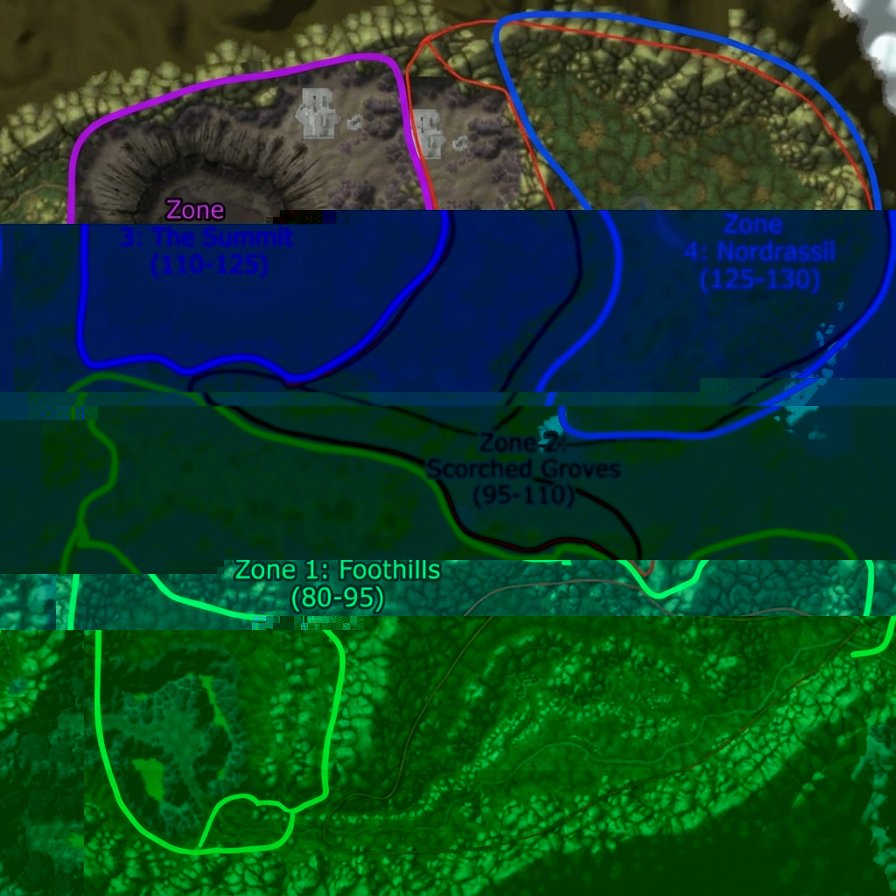
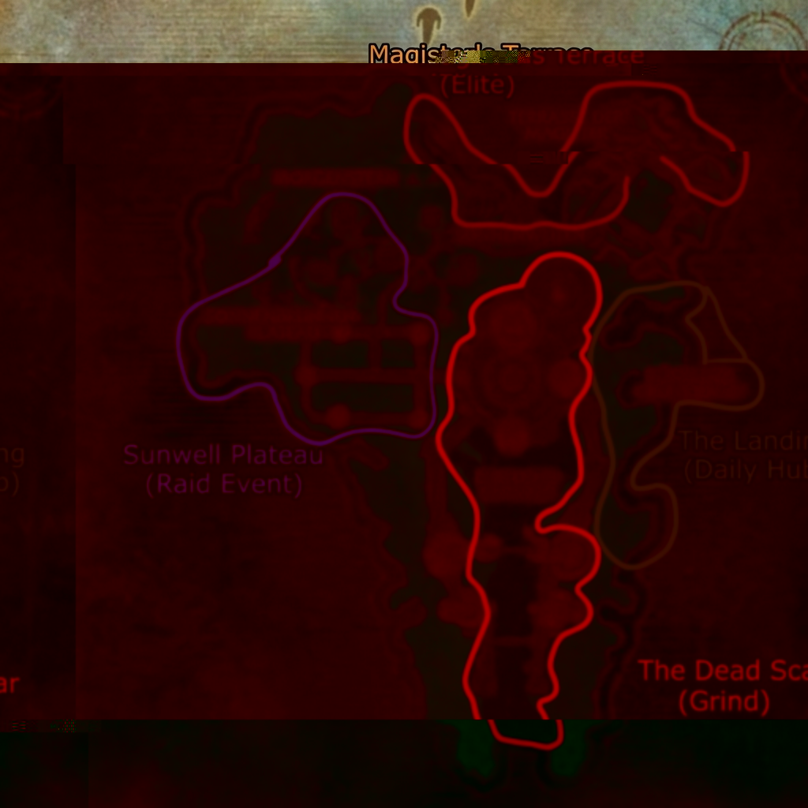

# Hyjal Summit Leveling Zone Evaluation
## Level 80-130 | DC-WoW AzerothCore 3.3.5a

> [!NOTE]
> Evaluation for the mid-range leveling zone (80-130) connecting WotLK endgame to Stratholme content.

---

## Table of Contents
1. [Zone Overview](#zone-overview)
2. [Leveling Tiers (80-130)](#leveling-tiers-80-130)
3. [Event Area: Sunwell Island](#event-area-sunwell-island)
4. [NPCs & Bestiary](#npcs--bestiary)

---

## Zone Overview

**Map ID:** **1410 (Hyjal Frontier)** — *new custom continent, open world*
**Directory (client):** `World\Maps\Hyjal130\`
**Zone IDs:** **6100** (root Hyjal Frontier) + 6101–6106 (tiers / camps)
**Entry ID Range:** **400,000+** (items), **830,000+** (creatures & GOs), **81,000+** (quests)
**Level Range:** 80 – 130
*   *Implementation (Option A, locked):* Clone the Mount Hyjal raid tileset
    (map 534 `HyjalPast`) into a fresh continent map `1410 Hyjal130`
    (InstanceType=0, Flags=16). The source raid stays untouched; the copy
    can be reshaped freely in Noggit without breaking the CoT Battle for
    Mount Hyjal raid. See `Custom/Level Areas/Hyjal 80 - 130/README.md`
    for the full ID lock-list and build order.

### Concept: "The Elemental War"
With the Lich King dead (Lv 80), the Elements and the Infinite Dragonflight assault the World Tree.
*   **Alliance Base:** Jaina's Encampment (Human/Night Elf).
*   **Horde Base:** Thrall's Camp (Orc/Tauren).
*   **Enemy Forces:** Burning Legion, Twilight Hammer, Elemental Lords.

---

---

## Zone Borders & Maps

### Hyjal Summit (Level 80-130)

*   **Zone 1 (Green): "The Foothills" (Level 80-95)** - Construction Camp & Lower Slopes.
*   **Zone 2 (Red): "The Scorched Groves" (Level 95-110)** - Ruins of Alliance/Horde bases.
*   **Zone 3 (Purple): "The Summit" (Level 110-125)** - Archimonde's Crater.
*   **Zone 4 (Blue): "Nordrassil Roots" (Level 125-130)** - World Tree Base.

### Sunwell Island (Event Zone)

*   **Zone A (Yellow): "The Landing"** - Sun's Reach Harbor.
*   **Zone B (Red): "The Dead Scar"** - Undead grinding road.
*   **Zone C (Orange): "Magister's Terrace"** - Elite outdoor area.
*   **Zone D (Purple): "Sunwell Plateau"** - Raid Event entrance.

---

## Leveling Tiers (80-130)

| Tier | Levels | Area | Theme |
|------|--------|------|-------|
| **1** | **80-95** | **The Foothills** (Alliance/Horde Base Entrances) | *Defense of the Camps.* Legion demons & Infernals attacking the gates. |
| **2** | **95-110** | **The Scorched Grooves** (Middle Map) | *The Elemental Front.* Fire Elementals vs Ancients. |
| **3** | **110-125** | **The Summit** (Archimonde's Crash Site) | *The Twilight Ascendant.* Cultists & massive Flesh Giants. |
| **4** | **125-130** | **Nordrassil Roots** (Top) | *The World Tree.* Infinite Dragonflight attempts to rot the tree. |

---

## Event Area: Sunwell Island (Clone)
*User Proposal: Cloned Sunwell / Isle of Quel'Danas*

**Concept:** "The Eclipse of the Sunwell"
**Location:** Teleport from **Nordrassil Roots (Tier 4)**.
**Type:** **Open World Event Zone (Tier 4.5 - Lv 130 Prep)**
*   **Map:** Isle of Quel'Danas (Map 530)
*   **Features:**
    *   **Magister's Terrace (Open):** Elite grinding spot for "Sunmote" currency.
    *   **The Dead Scar:** Infinite spawning undead waves (Grind Fest).
    *   **Sunwell Plateau (Interior):** World Boss Area (Kil'jaeden's Shadow).

### Technical Strategy (Sunwell)
*   **Option A: Phase/Script Existing Map (530).** Easy, but conflicts with TBC content slightly if players go there normally.
*   **Option B: Map Copy (Clone).** Cleanest (See Stratholme Appendix).
*   **Option C: Object Placement.** (Not viable for a whole island).

*Recommendation: Option A (Phased/Instanced Version)*

## Sunwell Event Mechanics
*Location: Phased/Instanced Map 530 (Isle of Quel'Danas).*

### 1. Global Mechanic: "The Solar Eclipse"
*   **Visual:** Zone weather is forced to **Darkness/Void Sky** (ID 46 or similar).
*   **Effect:** **"Shadow of the Sun"** - Players take 1% Shadow Damage every 10 seconds if not near a Light Beacon (Bonfire). This forces players to move between "Safe Zones".

### 2. The Dead Scar (Endless Defense)
*   **Concept:** A "Tower Defense" style lane.
*   **Mechanic:** Endless waves of Undead move from the south gate towards the Sunwell.
*   **Player Goal:** Kill as many as possible before they breach the gate. Higher kill count = More XP/Sunmotes.
*   **Mobs:** Risen Soldiers (Lv 128), Abominations (Lv 129).

### 3. Currency: "Sunmotes"
*   **Source:** Drops from all mobs on the Island and Daily Quests at "The Landing".
*   **Vendor:** Shattered Sun Quartermaster (At the Landing).
*   **Rewards:**
    *   **Level 130 Starter Gear:** "Eclipse Forged" sets (Entry-level for Stratholme).
    *   **Mount:** [Golden War Talbuk].
    *   **Consumable:** "Potion of Liquid Light" (Immunity to Eclipse damage for 10 min).

### 4. World Boss: Kil'jaeden's Shadow
*   **Location:** Sunwell Plateau (Courtyard).
*   **Spawn:** Every 4 hours.
*   **Loot:** **[Thori'dal, the Stars' Fury]** (Scaled for Lv 130) + 50 Sunmotes.

---
## NPCs & Bestiary (Expanded ~105 Templates)

### Faction Bases (Friendly)
*Essential services for the 80-130 journey.*

#### 1. Jaina's Expedition (Alliance - Zone 1)
*Location: The Construction Camp (South West).*
*   **Leader:** **Lady Jaina Proudmoore** (Lv 130 Boss) - *Model: 25968*
*   **Guards:**
    *   **Theramore Footman** (Lv 120 Elite) - *Equip: Sword/Shield (Stormwind Set)*
    *   **Kirin Tor Battle-Mage** (Lv 120 Elite) - *Equip: Staff*
*   **Services:**
    *   **Alliance Flightmaster** (Hippogryph)
    *   **Innkeeper Jessica** (Bind Point)
    *   **Blacksmith Arlan** (Repair/Plate Vendor)
    *   **Magus Trello** (Reagents/Portal Trainer)

#### 2. Thrall's Vanguard (Horde - Zone 1)
*Location: The Construction Camp (South East).*
*   **Leader:** **Warchief Thrall** (Lv 130 Boss) - *Model: 4527*
*   **Guards:**
    *   **Orgrimmar Grunt** (Lv 120 Elite) - *Equip: Axe (Orgrimmar Set)*
    *   **Darkspear Headhunter** (Lv 120 Elite) - *Equip: Spear*
*   **Services:**
    *   **Horde Flightmaster** (Wyvern)
    *   **Innkeeper Grog** (Bind Point)
    *   **Smithy Goruh** (Repair/Plate Vendor)
    *   **Shaman Zarek** (Reagents/Totem Vendor)

### Zone 1: The Foothills (Level 80-95) - "The Legion"
*Target Count: 20 Templates*

| Name | Level | Model ID | Weapon/Equip | Notes |
|------|-------|----------|--------------|-------|
| **Fel Vanguard** | 80-82 | 18608 | Felguard Axe | Primary melee. |
| **Wrathguard Invader** | 82-84 | 21338 | Dual Warglaives | Dual-wield DPS. |
| **Eredar Warlock** | 83-85 | 18236 | Staff | Shadowbolt caster. |
| **Succubus Seductress** | 81-83 | 18646 | Whip | CC/Charm. |
| **Felhound Tracker** | 81-83 | 20546 | None | Anti-caster/Silence. |
| **Doomlord Commander** | 85-88 | 21321 | 2H Sword | Elite Patrol. |
| **Mo'arg Engineer** | 82-84 | 19329 | Wrench | Spawns turrets. |
| **Gan'arg Worker** | 80-81 | 19337 | Hammer | Low HP swarm. |
| **Infernal Crash** | 85 | 16298 | None | AoE Stun spawn. |
| **Felscales Basilisk** | 82-84 | 21762 | None | Local beast corruption. |
| *+10 More Variants* | | | | (Detailed in SQL) |

### Zone 2: Scorched Groves (Level 95-110) - "The Fire"
*Target Count: 20 Templates*

| Name | Level | Model ID | Weapon/Equip | Notes |
|------|-------|----------|--------------|-------|
| **Cinder Spirit** | 95-98 | 24393 | None | Fire elemental. |
| **Molten Giant** | 99-102 | 11467 | None | Heavy Tank mob. |
| **Core Hound Runt** | 97-100 | 11671 | None | Double attack. |
| **Flamewaker Elite** | 98-101 | 11663 | Staff | Armor debuff. |
| **Charred Ancient** | 100-105| 24043 | None | Treant (Burning). |
| **Burning Dryad** | 99-103 | 24044 | Spear | Poison/Fire DoT. |
| **Lava Surger** | 101-104| 12129 | None | Ranged Earth shock. |
| **Phoenix Hawk** | 96-99 | 17975 | None | Flying mob. |
| **Fire Plume** | 105 | 24393 | None | Static turret mob. |
| **Baron Geddon's Echo** | 110 | 12129 | None | Rare Elite. |
| *+10 More Variants* | | | | (Detailed in SQL) |

### Zone 3: The Summit (Level 110-125) - "The Twilight"
*Target Count: 20 Templates*

| Name | Level | Model ID | Weapon/Equip | Notes |
|------|-------|----------|--------------|-------|
| **Twilight Cultist** | 110-112| 30971 | Dagger/Cowl | Generic humanoid. |
| **Twilight Enforcer** | 112-115| 30972 | 2H Axe | Plate wearer. |
| **Twilight Geomancer** | 113-116| 30973 | Staff | Earth spells. |
| **Faceless Void** | 115-118| 28067 | None | Shadow dmg (Old God). |
| **Twilight Drake** | 116-120| 26978 | None | Flying breath attack. |
| **Elementium Monstrosity**| 118-122| 11469 | None | Rare spawn. |
| **Ascendant Lord** | 120-125| 31102 | None | Elemental Hybrid. |
| **Corrupted Hill Giant**| 114-117| 21676 | Club | Elite heavy hitter. |
| **Twilight Assassin** | 111-114| 30971 | Dual Daggers | Stealth rogue. |
| *+10 More Variants* | | | | (Detailed in SQL) |

### Zone 4: Nordrassil (Level 125-130) - "The Infinite"
*Target Count: 25 Templates*

| Name | Level | Model ID | Weapon/Equip | Notes |
|------|-------|----------|--------------|-------|
| **Infinite Whelp** | 125 | 21251 | None | Swarm. |
| **Infinite Slayer** | 126-128| 20436 | 2H Polearm | Drakonid model. |
| **Infinite Chronomancer**| 127-129| 20437 | Staff | Time stop stun. |
| **Time-Lost Proto Drake**| 128-130| 27694 | None | Flying elite. |
| **Rift Anomaly** | 129 | 23164 | None | Voidwalker model. |
| **Epoch Hunter** | 130 | 19639 | None | Rare Elite Boss. |
| **Corrupted Aspects** | 128 | Various | None | Nightmare ghosts. |
| *+15 More Variants* | | | | (Detailed in SQL) |

---

---

## Balance Framework (added during scaffolding)

### XP curve 80 -> 130
The vanilla 3.3.5a XP table stops at 80. The custom extension uses a
compounding `+8% per level` curve so tier pacing stays consistent with
quest/kill density:

| Level | XP to next (approx) | Notes |
|-------|---------------------|-------|
| 80    | 1,686,300           | baseline (WotLK last step x1.08) |
| 90    | 3,640,000           | Scorched Groves tier opens |
| 100   | 7,860,000           | Summit tier opens |
| 110   | 16,970,000          | Nordrassil Roots tier opens |
| 120   | 36,630,000          | prep for Sunwell 130 event |
| 130   | ---                 | cap |

Server-side the curve lives in `Player::XPForLevel` (or an override
table under `sql/custom` once the numbers are finalized).

### Mob HP / damage scaling
Three tiers share model/faction with CoT Hyjal but rescale through
`creature_template` columns:

| Tier           | Level | HealthModifier | DamageModifier | ArmorModifier |
|----------------|-------|----------------|----------------|---------------|
| Foothills      | 80-90 | 10             | 1.1            | 1.0           |
| Scorched Groves| 90-105| 18             | 1.4            | 1.2           |
| Summit         |105-120| 30             | 1.8            | 1.4           |
| Nordrassil Roots|120-130| 45            | 2.3            | 1.6           |

Elites inside each tier are a single-step rescale
(`HealthModifier x1.8`, `DamageModifier x1.25`), not a new tier.

### Item tiers (entries 400,000-400,999)
* **Tier-1 Emberwood** (ilvl 300-316)  crafted / quest greens & blues.
* **Tier-2 Skyfire**   (ilvl 332-352)  Summit drops + Emberwood Sap
  quartermaster (see below).
* **Tier-3 Nordrassil**(ilvl 372-398)  rare drops from Nordrassil Roots
  + Sunwell 130 event rewards.
* **Tier-4 Ascendant** (ilvl 412) � class-restricted level-130 signature
    rewards plus full PvE and PvP endgame catalogs.

### Item scaling split by source

To avoid a flat 264 vendor wall across the whole zone, Hyjal item rewards are
split by both source and tier:

| Source band | Player level | Item level | Quality | Notes |
|-------------|--------------|------------|---------|-------|
| Foothills quest rewards | 80-95 | 264 | Rare | First reliable upgrades from camp defense chains |
| Foothills loot drops | 80-95 | 277 | Epic | Rare elites and named invaders |
| Scorched quest rewards | 95-110 | 284 | Rare | Elemental Front progression quests |
| Scorched loot drops | 95-110 | 297 | Epic | Rare elites and event commanders |
| Summit quest rewards | 110-125 | 304 | Rare | Twilight story chains and crater objectives |
| Nordrassil loot drops | 125-130 | 317 | Epic | Infinite Dragonflight rares and root guardians |

Stat growth is tuned as a simple upward ramp from the 264 ICC baseline so the
custom 130 cap still feels like progression instead of recolored sidegrades:

| Band | Primary stat scale vs 264 | Stamina scale vs 264 | Secondary stat scale vs 264 |
|------|---------------------------|----------------------|-----------------------------|
| 264 quest | 1.00x | 1.00x | 1.00x |
| 277 loot | 1.13x | 1.13x | 1.13x |
| 284 quest | 1.22x | 1.22x | 1.22x |
| 297 loot | 1.36x | 1.36x | 1.36x |
| 304 quest | 1.46x | 1.46x | 1.46x |
| 317 loot | 1.63x | 1.63x | 1.63x |
| 412 signature | 2.17x | 2.17x | 2.17x |

Yes: the stats are scaled up. The late-game items borrow ICC names and
display identities as anchors, but the actual stat budgets were raised to fit
the custom 304, 317, and 412 Hyjal bands instead of staying at raw Wrath
numbers. The 412 ceiling was chosen because live heroic ICC upgrade chains in
the current item-upgrade system already reach that band on real raid items;
the higher 435 and 740 values in the live DB are QA or recursive-clone data,
not normal endgame loot targets.

For the new Ascendant tier-set pieces, the source rows are the real 277
Sanctified ICC set pieces and their stats are scaled with the live heroic
upgrade multiplier of 1.45x so the Hyjal endgame follows the same top-end
shape as the current upgrade system.

For the PvP block, the source rows are the equippable Wrathful Gladiator items.
Those rows are normalized to ilvl 412 with a per-item source ratio so weapons,
set pieces, rings, trinkets, cloaks, relics, and offset armor all land in the
same Hyjal endgame band even though the original Wrathful catalog spans
multiple source item levels.

For the full ICC PvE block, the source rows are derived from the actual ICC
map 631 creature loot and cache loot tables, then deduplicated by item name so
Hyjal keeps one highest-source analogue per real ICC gear concept. That block
is supplemented with the Ashen Verdict Endless rings and the Lich King endpoint
weapons plus Shadowmourne, then normalized to the same ilvl 412 band so the
zone has the full ICC-style gear surface without cloning every 10- and 25-man
variant separately.

### Class and talent coverage

The first broad implementation lives in
`Custom/Level Areas/Hyjal 80 - 130/07_Quest_Loot_Items.sql` and establishes the
five baseline role lanes (caster, healer, agility, strength, tank) across the
80-130 route.

To keep class progression from collapsing into shared accessories only,
`Custom/Level Areas/Hyjal 80 - 130/08_Class_Armor_And_Endgame_Items.sql`
adds a second layer:

* 12 Summit class-core chest pieces at ilvl 372 for the major armor/spec
    archetypes: cloth caster, cloth healer, leather balance, leather resto,
    leather agility, leather tank, mail elemental, mail resto, mail agility,
    plate holy, plate strength dps, and plate tank.
* 12 Nordrassil helms at ilvl 398 for the same archetype spread so late-route
    upgrades exist outside rings, cloaks, and necklaces.
* 30 class-restricted level-130 signature items at ilvl 412 in the dedicated
    source block `400200-400229`, one for each
    Wrath talent tree, using ICC best-in-slot items as the source flavor.
* 95 Ascendant tier-set items at ilvl 412 in `09_Endgame_Tier_Sets.sql`,
    covering every non-clone 277 Sanctified ICC tier name across warrior,
    paladin, hunter, rogue, priest, death knight, shaman, mage, warlock,
    and druid sets.
* 123 ICC PvE analogues at ilvl 412 in `11_ICC_Endgame_Gear.sql`, covering
    the highest-source non-tier ICC raid-drop catalog, the Ashen Verdict
    Endless rings, and the Lich King endpoint weapons plus Shadowmourne.
* 60 leveling expansion pieces in `12_Leveling_Expansion.sql` at
    the full 400041-400124 leveling block (sorted by required level),
    filling the wrists / waist / hands / feet / shoulders /
    legs slots across all five role archetypes in all four sub-bands
    (Foothills iLvl 300 req 82, Scorched 332 req 97, Summit 372 req 112,
    Nordrassil Roots 317 req 127). This closes the gap between rings,
    cloaks, pendants, chests and helms so a level 80 character has a
    continuous quest-reward surface all the way to level 130.

### PvP coverage

`Custom/Level Areas/Hyjal 80 - 130/10_PvP_Endgame_Gear.sql` prepares a
dedicated PvP endgame block in `400500-400707`, deliberately separated from
the contiguous PvE endgame range `400200-400447`.

* 208 equippable Wrathful Gladiator analogues, excluding only the Frost Wyrm
    mount because this block is intended for wearable or wieldable gear.
* 80 set pieces plus 128 offset items, preserving the original Wrathful PvP
    setup instead of collapsing PvP into only a few weapons and trinkets.
* Coverage includes full class sets, melee and caster weapons, shields,
    off-hands, idols, librams, sigils, totems, cloaks, necklaces, rings,
    trinkets, belts, boots, bracers, and the tabard.
* The SQL clones the live source rows while preserving sockets, itemset ids,
    weapon damage curves, proc and on-use spell data, and other slot-specific
    metadata that would be awkward to recreate by hand.

ID separation is now explicit for future upgrade tooling, with PvE and PvP
endgame gear placed in disjoint ranges:

* `400011-400040` -> quest rewards + elite loot drops (ilvl 300-398).
* `400041-400124` -> leveling gear sorted by required level, covering
   chests/helms/wrists/belts/hands/feet/shoulders/legs (ilvl 300-398).
* (reserved) Historical note: the pre-resort layout kept class-core
   chests + helms in `400041-400064` and expansion slots in
   `400065-400124`; both ranges are now interleaved by required level.
    shoulders, legs across all four sub-bands).
* `400125-400199` -> reserved for future leveling variants or helpers.
* `400200-400229` -> level-130 endgame PvE signature items.
* `400230-400324` -> endgame PvE Ascendant ICC tier-set analogues.
* `400325-400447` -> endgame PvE ICC raid-drop catalog.
* `400448-400499` -> reserved for future endgame PvE expansion.
* `400500-400707` -> endgame PvP Wrathful catalog (only PvP block).
* `400708-400999` -> reserved for future expansion.

The PvE endgame is now contiguous through `400200-400447` and the PvP
endgame lives entirely in `400500-400707` with no overlap, so upgrade
chains, vendor pools and loot wiring can iterate either pool in isolation.

This gives Hyjal immediate support for every class and talent tree even before
full quest reward wiring and endgame boss tables are authored.

### Currency: "Emberwood Sap" (item 400000)
Reward token dropped by every hostile mob on map 1410 (weighted by rank:
normal 1, elite 5, rare/boss 25). Stack size 5000. Redeemed at
`Emberwood Sap Quartermaster` (creature 830024, ScriptName
`npc_hyjal_emberwood_vendor`) for Tier-2 gear, recipes, and mount
tokens. The quartermaster's stock is gated by the zone-wide
"Tree Health" world state so the catalog expands as players push back
the invasion � this is the long-running hook that keeps the zone
active after a character caps.
